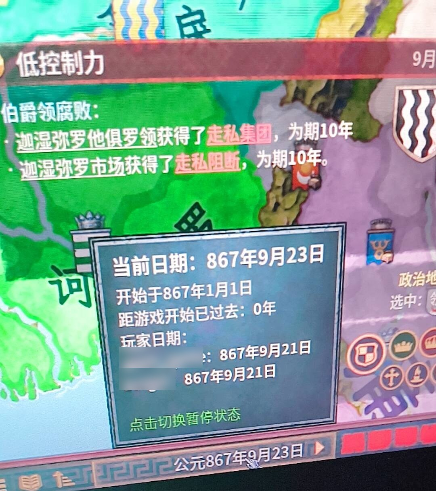
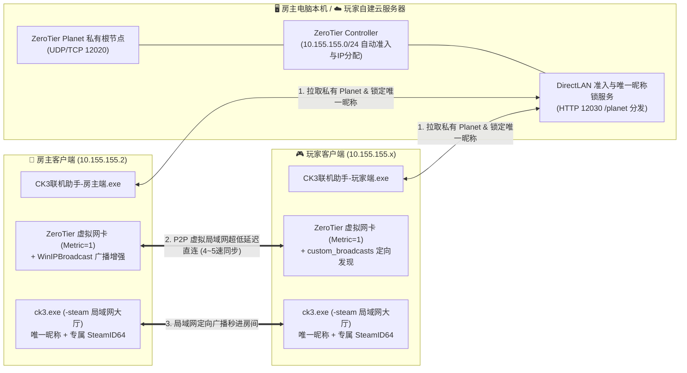

# 👑 CK3-更好的私人联机助手-DirectLAN — 《十字军之王3 / 王国风云3》自建虚拟局域网 P2P 高速直连联机方案

<p align="center">
  
  
  
  
  
</p>

<p align="center">
  <b>开源独立版 · 零商业后台依赖 · 支持【玩家电脑对电脑直连】与【玩家自建云服务器】 · 免外部中继登录 · 全服唯一联机昵称锁 · 实测 4~5 速稳定同步</b>
</p>

---

## 📖 项目简介 (Overview)

**CK3-DirectLAN（CK3-更好的私人联机助手）** 是一套完全开源、零第三方商业服务器依赖的《十字军之王3 / 王国风云3 (*Crusader Kings III*)》虚拟局域网 (Virtual LAN) P2P 高速直连与多人房间管理工具。

针对原版 CK3 多人联机常见的 **跨国中继服务器高延迟、开局 2 速卡顿、副机玩家日期长期落后、跨网无法进入多人大厅、中后期频繁不同步 (OOS / Desync)** 等核心痛点，本项目通过 **自建 ZeroTier Planet 私有根服务器 + 自动化 Controller 节点准入 + DirectLAN 虚拟局域网大厅桥接 (`-steam`) + 最高路由跃点数 (`Metric=1`) + 全局定向广播转发 (`WinIPBroadcast`)**，将所有联机同步流量 100% 切换至玩家之间的 **P2P 虚拟专网直连**，实测在 1.18+《普天之下 (*All Under Heaven*) / 白银与丝绸 (*Silk & Silver*)》大型剧本下 **4~5 速稳定流畅同步**！

> **English Summary**: **CK3-DirectLAN** is an open-source, self-hosted Virtual LAN & P2P direct-connect multiplayer assistant for *Crusader Kings III (CK3)*. By combining a private ZeroTier Planet root server, automated network controller authorization, interface metric prioritization (`Metric=1`), and a local LAN lobby bridge (`-steam`), it eliminates overseas relay lag and keeps multiplayer dates synchronized at Speed 4–5 with minimal desync (OOS). Supports both **Host-to-Peer PC Direct Mode** (no VPS required) and **Self-Hosted Cloud VPS Mode**.

---

## 📸 实测联机效果展示 (Screenshots)

> **实测多人联机（1.18+ 东亚扩展大地图剧本）：4~5 速推进下，双方玩家日期完全同步（`867年9月21日`），无日期落后、无中继卡顿（注：截图中测试玩家昵称已做隐私脱敏模糊处理）：**

<p align="center">
  
</p>

<p align="center">
  
</p>

---

## 🏗️ 系统架构与工作流 (Architecture)



---

## ✨ 核心特性 (Key Features)

- 🔓 **免外部中继登录 · 局域网大厅直连**：
  - 自动配置 DirectLAN 局域网大厅桥接环境 (`-steam`)，无需等待外部跨国中继账号登录，游戏主菜单【多人游戏】直接亮起可用。
  - 根据每台设备自动生成**专属唯一 64 位会话标识 (`SteamID64`)**，多人存档读档时自动认领各自上次游玩的领主角色。
- 🔒 **全服唯一联机昵称锁（防撞名与角色错乱）**：
  - 玩家在客户端顶部输入的**联机昵称**即为游戏内的唯一联机身份。
  - 主节点实时校验并锁定昵称唯一性：**当前玩家绑定某昵称后，其他人无法使用同名昵称；当本人修改昵称时，旧昵称自动释放**，房主也可在控制台一键释放指定昵称锁。
- 🌐 **支持两种完全自主的联机拓扑（零第三方服务器依赖）**：
  1. **🖥️ 玩家电脑对电脑直连模式 (Host-to-Peer，免买云服务器)**：房主直接在软件右上角点击 **【🖥️ 本机一键做主机】**，程序自动在房主电脑拉起内置的 Planet 根节点与 Controller 服务，朋友输入房主电脑 IP 即可直连。
  2. **☁️ 玩家自建云服务器模式 (Self-Hosted VPS)**：提供 Linux ([deploy_linux_server.sh](server/deploy_linux_server.sh)) 与 Windows ([start_windows_server.bat](server/start_windows_server.bat)) 一键开服脚本，1 分钟即可在自己的轻量服务器上搭好 24 小时运行的专属 Planet 联机中心。
- ⚡ **6 步底层虚拟局域网全自动调优**：
  - `[1/6]` 自动从主节点同步加密签名的私有 `planet` 文件并生成 `local.conf`（支持 TCP 中继回退）
  - `[2/6]` 自动部署 `zttap300` 虚拟网卡驱动与目录权限
  - `[3/6]` 启动独立端口 (`56814`) 的 ZeroTier 核心守护进程（不与系统原有软件冲突）
  - `[4/6]` 自动加入虚拟局域网 (`10.155.155.0/24`)
  - `[5/6]` 主节点 Controller 秒级自动授权节点并分配固定虚拟 IP（无需去网页后台手动打勾）
  - `[6/6]` 自动启动 `WinIPBroadcast` 局域网广播转发、将虚拟网卡路由跃点数设为 `Metric=1`（最高优先级），并将全员虚拟 IP 实时写入 `custom_broadcasts.txt` 实现双向秒搜房。
- 🔄 **一键无损还原官方默认模式**：
  - 随时点击 **【🔄 还原官方默认模式】** 即可 100% 恢复 Steam 原版文件、云存档与成就系统。

---

## 🚀 快速使用指南 (Quick Start)

> 💡 **开箱即用版下载**：请前往右侧 **[Releases 页面](../../releases/latest)** 下载最新的 **`CK3-DirectLAN-v1.0.0-Windows-x64.zip`**，解压后即可直接运行图形界面！

### 模式 A：玩家电脑对电脑直连（无需购买云服务器）

1. **房主开启本机主节点**：
   - 房主运行 `CK3联机助手-房主端.exe`（或玩家端），点击右上角 **【🖥️ 本机一键开启主节点 (电脑直连开服)】**。
   - 输入房主电脑可供朋友访问的 IP（若在同一局域网/校园网/异地组网内，填本机内网 IP；若通过路由器端口映射/公网 IP 直连，填公网 IP 并映射 `TCP 12030` 与 `UDP/TCP 12020`）。
2. **所有玩家连入专网**：
   - 房主与朋友在顶部 **【🌐 自建服 / 房主电脑 IP】** 填入房主 IP，端口填 `12030`。
   - 在 **【👤 专属联机昵称】** 输入各自唯一的英文或数字昵称，点击 **【⚡ 启用虚拟局域网大厅桥接】**。
   - 点击 **【🚀 一键连入专网】**，等待指示灯变为 **🟢 绿灯**。
3. **启动游戏畅玩**：
   - 点击 **【⚔️ 启动 CK3 开始联机】** 进入游戏主菜单 -> 直接点击 **【多人游戏】** 即可秒搜到房主房间！

---

### 模式 B：玩家自行搭建云服务器（推荐长期多好友联机）

如果你有一台轻量应用服务器或 VPS（Ubuntu / Debian / CentOS 均可，1核1G 即可流畅带动）：

1. 将本仓库 `server/` 目录下的 [lan_server.py](server/lan_server.py) 和 [deploy_linux_server.sh](server/deploy_linux_server.sh) 上传至你的云服务器同一目录。
2. 执行一键部署命令：
   ```bash
   chmod +x deploy_linux_server.sh
   sudo ./deploy_linux_server.sh <你的服务器公网IP> <自定义房主管理密码> 12030 12020
   ```
3. 在云服务器防火墙/安全组放行以下端口：
   - **`TCP 12030`**（准入控制、唯一昵称锁与 `/planet` 自动分发）
   - **`UDP 12020`** 与 **`TCP 12020`**（ZeroTier Planet 核心 P2P 握手与中转端口）
4. 所有玩家打开客户端，在顶部填入你的 **`服务器公网IP`** 与端口 **`12030`**，点击 **【🚀 一键连入专网】** 即可 24 小时随时绿灯联机！

---

## 🛠️ 从源码运行与打包 (Build from Source)

### 1. 环境要求
- Windows 10 / 11 (x64)
- Python 3.10+

### 2. 直接运行源码
```powershell
# 启动玩家端 (需管理员权限以配置虚拟网卡跃点数 Metric=1)
python client/ui_user.py

# 启动房主控制台
python client/ui_admin.py
```

### 3. 使用 PyInstaller 打包独立 `.exe`
```powershell
pip install pyinstaller
python package_dist.py 1.0.0
```
打包完成后，独立可执行程序将生成在 `dist/CK3联机助手-玩家端/` 与 `dist/CK3联机助手-房主端/` 目录下。

---

## ❓ 常见问题与联机防掉速 / 防不同步 (OOS) 指南

### Q1：网上说打 UMMS 等联机优化模组可以降低延迟，是真的吗？
- **物理网络延迟 (Network Ping)**：MOD 只能修改游戏脚本，不能改变物理网络延迟（物理网络延迟已由本工具的 **自建 Planet + 虚拟局域网 P2P 直连** 压到最低）。
- **逻辑运算卡顿 / 中后期掉速 (Daily Tick Lag)**：**是真的有效**。CK3 多人联机采用严格的“按日同步（Daily Lockstep）”机制，每天所有玩家的电脑必须算完地图上数万名 AI 角色的事件与寻路并比对校验和后，日期才会推进。中后期无领地路人 AI 角色成倍膨胀时，搭配 **UMMS (Unofficial Multiplayer Mod)** 或 **Population Control（人口控制）** 模组，能大幅减少无意义的 AI 轮询与每天跨网同步的数据量，配合本工具的 P2P 专网直连，中后期依然能稳定维持 4~5 速且极少发生不同步 (OOS)。

### Q2：为什么显示已绿灯连接，但在游戏【多人游戏】大厅里搜不到房主房间？
1. 请确认房主和所有玩家都已点击 **【⚡ 启用虚拟局域网大厅桥接】**，并通过软件面板上的 **【⚔️ 启动 CK3 开始联机】** 按钮启动游戏。
2. 点击软件上的 **【📡 网卡与NAT诊断】** -> 点击 **【⚡ 一键设 ZeroTier 跃点数为 1】**，如果有未在使用的 VMware / VirtualBox / Radmin / Hamachi 等多余虚拟网卡，建议在列表中将其临时禁用，防止游戏广播包发往错误的虚拟网卡。
3. 确认 Windows 防火墙已允许 `ck3.exe` 通过专用与公用网络。

### Q3：游戏内如何查看联机面板或切换显示语言？
- 本工具在启用局域网桥接时已默认将游戏显示语言配置为 **简体中文 (`schinese`)**，并将你在软件顶部锁定的唯一昵称同步至游戏配置。
- 进入游戏后，也可随时按键盘 **`Shift + Tab`** 查看内置局域网会话信息。

---

## ⚖️ 合规声明与开源协议 (Legal & Compliance Notice)

1. **纯网络组网与联机辅助定位**：本项目（**CK3-DirectLAN**）是一款基于开源点对点虚拟局域网（ZeroTier SD-WAN 协议）与路由跃点数自动化调优的**网络层联机辅助工具**，旨在解决复杂 NAT 环境下的多人局域网联机高延迟与掉线问题。
2. **正版支持声明**：本项目**不包含任何受版权保护的游戏本体代码或美术资产，亦不提供任何付费内容破解或盗版分发**。请广大玩家支持并购买 Steam 官方正版《Crusader Kings III (十字军之王3)》。
3. **无商业后台与零隐私收集**：本开源版本无任何中心化商业后台，所有网络通信仅发生在玩家自行搭建的节点或玩家对等计算机之间，不收集、不上传任何用户隐私数据。
4. **商标归属**：*Crusader Kings III* 及相关标识为 Paradox Interactive AB 的注册商标，本项目为玩家社区独立开源项目，与 Paradox Interactive AB 及 Valve Corporation 无任何官方关联。
5. **开源许可**：本项目源代码遵循 [MIT License](LICENSE) 开源协议，仅供个人学习、研究与非商业性局域网联机测试使用，严禁用于任何商业售卖或违规用途。
